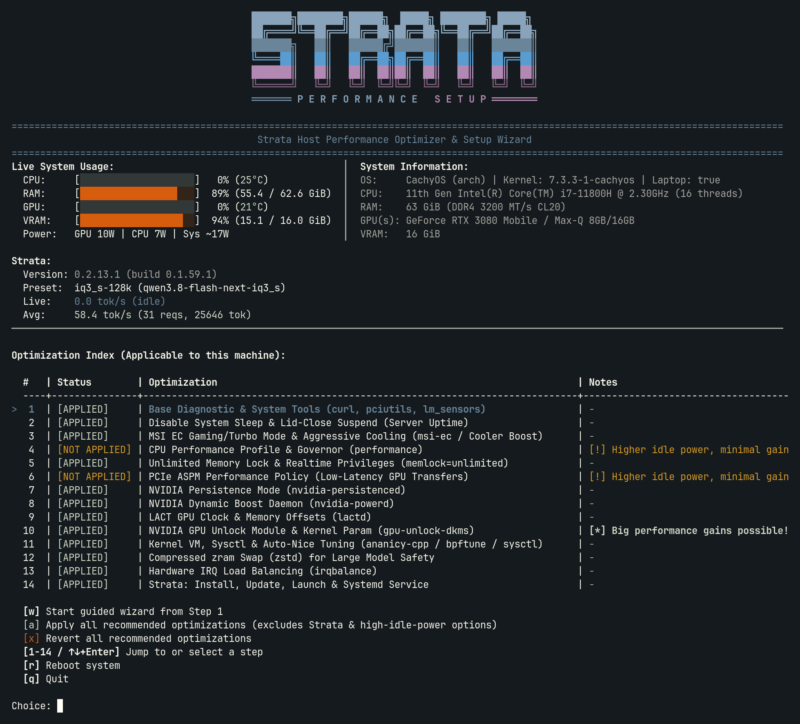

<p align="center">
  
</p>

# Strata Performance Setup

An interactive TUI wizard (`strata-performance-setup.sh`) to inspect, apply, and revert host-level Linux performance optimizations for running **Strata** LLM inference—and to install, update, launch, and manage `strata.service`.

The script automatically detects your distribution, CPU, RAM, GPU(s), laptop/chassis vendor, and bootloader, then presents only the optimizations applicable to your machine. Every optimization can be applied or reverted cleanly from the wizard.

<p align="center">
  
</p>

---

## Quick Start (Recommended)

### Run directly on your machine

```bash
curl -fsSL https://raw.githubusercontent.com/bramvanoploo/strata-performance-setup/main/strata-performance-setup.sh -o ~/strata-performance-setup.sh && chmod +x ~/strata-performance-setup.sh && ~/strata-performance-setup.sh
```

> **Why download instead of `curl ... | bash`?**  
> `strata-performance-setup.sh` is an interactive TUI that reads your menu selections from standard input. Saving it first keeps your terminal attached for interactive prompts and `sudo` authentication.

### Run on a remote machine via SSH

Replace `192.168.1.100` with your target machine's IP address (or `user@<ip>` if the remote username differs):

```bash
ssh -t 192.168.1.100 'curl -fsSL https://raw.githubusercontent.com/bramvanoploo/strata-performance-setup/main/strata-performance-setup.sh -o ~/strata-performance-setup.sh && chmod +x ~/strata-performance-setup.sh && ~/strata-performance-setup.sh'
```

### Clone the repository and run

```bash
git clone https://github.com/bramvanoploo/strata-performance-setup.git
cd strata-performance-setup
chmod +x strata-performance-setup.sh
./strata-performance-setup.sh
```

---

## Supported Distributions

The wizard supports systemd-based Linux distributions across three package families:

| Family | Supported Distributions | Package Manager |
| :--- | :--- | :--- |
| **Arch-based** | Arch Linux, CachyOS, EndeavourOS, Manjaro, Garuda (and `ID_LIKE=arch`) | `pacman` (plus `yay` or `paru` for AUR packages) |
| **Fedora-based** | Fedora, Nobara, RHEL, CentOS, Rocky Linux, AlmaLinux (and `ID_LIKE=fedora` / `rhel`) | `dnf` |
| **Debian-based** | Debian, Ubuntu, Pop!\_OS, Linux Mint, KDE neon (and `ID_LIKE=debian` / `ubuntu`) | `apt-get` |

> **Bootloaders:** Kernel command-line parameters (used when BIOS locks runtime PCIe ASPM writes or for `gpu-unlock`) are automatically configured for **Limine** (`/etc/default/limine`), **GRUB** (`/etc/default/grub` via `grub-mkconfig` or `grub2-mkconfig`), or **systemd-boot** (`/etc/kernel/cmdline`).

---

## Supported Hardware

The script probes your system at startup and enables hardware-specific steps only when matching hardware is detected:

### GPUs
- **NVIDIA** (GTX 16 / RTX 20 / RTX 30 / RTX 40 / A-series & L-series):
  - `nvidia-persistenced` persistence mode (eliminates cold-start delays on headless hosts)
  - `nvidia-powerd` Dynamic Boost (mobile RTX GPUs)
  - Persistent maximum GPU power limit (`nvidia-smi -pl` via systemd)
  - LACT (`lactd`) core & VRAM clock offsets
  - `gpu-unlock-dkms` + `gpu_unlock.targets=all` *(Arch-based distros, supported Turing/Ampere/Ada GPUs)*
- **AMD Radeon**:
  - `amdgpu` high-performance DPM level (`power_dpm_force_performance_level=high`) for ROCm/HIP
  - LACT (`lactd`) core & VRAM clock offsets
- **Intel Arc / Integrated GPUs**:
  - Minimum GPU frequency locked to RP0/max (supports both `xe` and `i915` kernel drivers) for SYCL

### Laptops & OEM Thermal / EC Controls
- **Generic ACPI Platform Profile** (`performance` mode via `/sys/firmware/acpi/platform_profile` — ThinkPad, IdeaPad, Legion, ASUS, HP, Dell, Acer, AMD PMF)
- **MSI** laptops (`msi-ec` + `ec_sys` turbo shift mode, advanced fan curve, optional Cooler Boost)
- **ASUS** ROG / TUF laptops (`asusctl` / `asusd` Performance profile)
- **Dell** systems (`smbios-thermal-ctl` BIOS ultra-performance mode)
- **Lenovo Legion** laptops (`LenovoLegionLinux` / `legiond`)
- **System76** (`system76-power` Performance profile)
- **TUXEDO** laptops (`tccd` / TUXEDO Control Center)

### System-Wide Optimizations (All Hardware)
- **Server Uptime:** Masks `sleep`, `suspend`, `hibernate`, and `hybrid-sleep` targets, and ignores laptop lid-close suspend
- **Memory & Realtime:** Grants unlimited `memlock`, `nice -11`, and `rtprio 98` so model weights and KV caches stay pinned in RAM
- **CPU & PCIe:** Optional CPU `performance` governor / `power-profiles-daemon` and PCIe ASPM `performance` policy
- **Kernel & Swap:** `sysctl` VM tuning (`vfs_cache_pressure=50`, `dirty_ratio=10`, `zone_reclaim_mode=0`), `ananicy-cpp` / `bpftune` on Arch/CachyOS, `zstd`-compressed `zram` swap, and `irqbalance`
- **Strata Management:** Installs or updates [Strata](https://github.com/Niko1221/Strata), runs `strata launch`, and sets up `strata.service` from a saved preset

> **Recommended Specs:** The wizard will warn if your system has under **32 GiB RAM** or under **6 GiB NVIDIA VRAM** (or no dedicated NVIDIA/AMD/Intel Arc GPU), as larger models may not fit in memory, though you can still apply any applicable host optimizations.

---

## Live Dashboard & Strata Monitoring

The header continuously refreshes every **1 second** without interrupting your input:

- **Live System Usage (left):** Color-coded bars for CPU usage + temperature, RAM usage, per-GPU utilization + temperature and VRAM (supports single and multi-GPU NVIDIA/AMD setups), and horizontal `Power:` (`GPU`, `CPU`, and `Sys` watts).
  - *Tip:* On systems without a PSU or battery hwmon sensor, run with `sudo` (`sudo ~/strata-performance-setup.sh`) so the script can read root-only `intel-rapl` energy counters for `CPU` and `Sys` power.
- **System Information (right):** OS, kernel, CPU model/threads, RAM capacity/speed/timings, GPU model(s), total VRAM, and NVIDIA power limits.
- **Strata Block:** Installed Strata version, active serving preset and model, live `tok/s`, and session average `tok/s` (request and token totals).
- **Active Update Polling:** Checks for Strata updates in the background every **60 seconds**, displays an `[UPDATE AVAILABLE]` banner on every screen when a new version is found, and lets you press `u` to stop `strata.service`, run `strata update --yes`, restart `strata.service`, and notify you once the model is `[LIVE]` again.

---

## Using the Wizard

Once launched, the main index lists every optimization applicable to your machine along with its live `[APPLIED]` / `[NOT APPLIED]` status:

- Navigate the index with **`↑` / `↓`** and press **`Enter`** (or type a **step number**) to open a step, or press `w` to walk through the **guided wizard** step by step
- Press `a` to **apply all recommended optimizations** for your hardware in one action (with confirmation; excludes Strata setup and minimal-gain/higher-idle-power options like CPU Performance and PCIe ASPM)
- Press `x` to **revert all recommended optimizations** in one action (with confirmation)
- Press `u` (when shown) to **install a pending Strata update** and restart `strata.service`
- Press `r` on the index to **reboot** the system (the wizard also prompts automatically whenever a kernel-parameter change requires a reboot)
- Inside any step, press `a` to **apply** (when not yet applied, or to open the Strata Manager menu), `r` to **revert** (when applied), `n` / `b` to move next/back, or `i` / `Esc` to return to the index

---

## Credits & Third-Party Projects

This wizard relies on and integrates with the following open-source projects for hardware control, system tuning, and LLM serving (beyond standard OS/kernel utilities):

| Project | Role in Wizard | Repository |
| --- | --- | --- |
| **Strata** | LLM inference engine, CLI, updates, and `strata.service` | [Niko1221/Strata](https://github.com/Niko1221/Strata) |
| **LACT (`lactd`)** | GPU core & VRAM clock offset tuning (NVIDIA / AMD / Intel) | [ilya-zlobintsev/LACT](https://github.com/ilya-zlobintsev/LACT) |
| **gpu-unlock** | NVIDIA consumer GPU SM/tensor unlock kernel module (`gpu-unlock-dkms`) | [Zagitta/gpu-unlock](https://github.com/Zagitta/gpu-unlock) |
| **msi-ec** | MSI laptop Embedded Controller driver for shift/fan/Cooler Boost | [MControlSuite/msi-ec](https://github.com/MControlSuite/msi-ec) |
| **MControlCenter** | MSI laptop cooling and performance profile companion app | [dmitry-s93/MControlCenter](https://github.com/dmitry-s93/MControlCenter) |
| **asusctl** | ASUS laptop performance and fan profile control (`asusd`) | [asus-linux/asusctl](https://gitlab.com/asus-linux/asusctl) |
| **LenovoLegionLinux** | Lenovo Legion fan & power mode control (`legion_cli`) | [johnfanv2/LenovoLegionLinux](https://github.com/johnfanv2/LenovoLegionLinux) |
| **system76-power** | System76 laptop power & performance profile daemon | [pop-os/system76-power](https://github.com/pop-os/system76-power) |
| **TUXEDO Control Center** | TUXEDO laptop power/cooling daemon (`tccd`) | [tuxedocomputers/tuxedo-control-center](https://github.com/tuxedocomputers/tuxedo-control-center) |
| **libsmbios** | Dell thermal management CLI (`smbios-thermal-ctl`) | [dell/libsmbios](https://github.com/dell/libsmbios) |
| **ananicy-cpp** | Automatic process nice/scheduler tuning daemon | [ananicy-cpp/ananicy-cpp](https://gitlab.com/ananicy-cpp/ananicy-cpp) |
| **bpftune** | eBPF-driven automatic Linux kernel & sysctl tuning | [oracle/bpftune](https://github.com/oracle/bpftune) |
| **irqbalance** | Multi-core hardware IRQ load-balancing daemon | [Irqbalance/irqbalance](https://github.com/Irqbalance/irqbalance) |
| **zram-generator** | Systemd generator for `zstd`-compressed zram swap (Arch / Fedora) | [systemd/zram-generator](https://github.com/systemd/zram-generator) |
| **zram-tools** | `zramswap` service for `zstd`-compressed zram swap (Debian / Ubuntu) | [highvoltage/zram-tools](https://github.com/highvoltage/zram-tools) |

---

## License

See [LICENSE](LICENSE).
