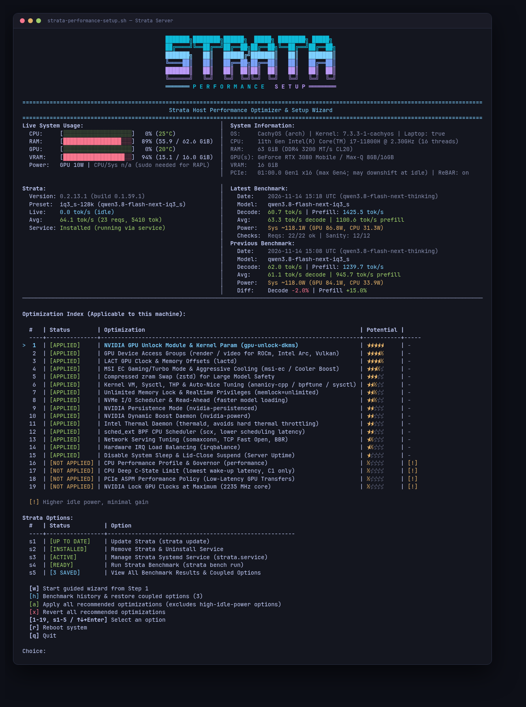

<p align="center">
  
</p>

An interactive TUI wizard (`strata-performance-setup.sh`) to inspect, apply, and revert host-level Linux and macOS (Apple Silicon) performance optimizations for running **Strata** LLM inference—and to install, update, launch, and manage `strata.service` (`systemd` / SysVinit) or `com.strata.server` (`launchd`) (or run in host-tuning mode when Strata is deployed in Docker on hosts like Unraid, TrueNAS SCALE, or Synology DSM).

The script automatically detects your OS/distribution, CPU/SoC, RAM/unified memory, GPU(s), laptop/chassis vendor, and bootloader, then presents only the optimizations applicable to your machine. Every optimization can be applied or reverted cleanly from the wizard, with clear legend badges (`[!]`, `[OPT]`, `[EXP]`, `[L]`) distinguishing default-recommended steps from opt-in trade-offs, experimental options, and laptop-safe optimizations. It covers consumer and workstation GPUs alongside datacenter/inference accelerators (NVIDIA Tesla/A100/L40/H100/B200 hardening, DGX Spark `GB10`, Jetson Orin/Xavier/Thor/TX2, AMD Instinct `MI50`–`MI355X` and Radeon APUs/dGPUs, Intel Arc Alchemist/Battlemage `B580`/`Pro B60`, and Apple Silicon M1–M5+ on macOS 15+ as well as Intel Macs running Linux). On systems with AMD GPUs or unified-memory APUs lacking an official prebuilt Strata Linux engine (such as Strix Point `gfx1150`, Phoenix/Hawk Point `gfx1103`, Krackan `gfx1152`, RDNA 1/2, or Instinct CDNA/Vega wave64), it also detects the exact `gfx` architecture, wires required experimental opt-ins and kernel workarounds (`amd_apu_memory`, `amd_cwsr_disable`), and can build, package, and register a self-contained local HIP engine directly from `[STRATA]`.

> **Note:** Host-level tuning complements—but does not replace—Strata's own serving configuration. On VRAM-constrained GPUs, check your serving/prefill chunk settings (e.g. `auto` vs. pinned) before chasing marginal OS-level gains. On macOS, macOS ships Bash 3.2 at `/bin/bash`; install modern Bash via Homebrew (`brew install bash`) if prompted—the script automatically re-execs under Homebrew Bash 4.3+.

<p align="center">
  
</p>

---

## Quick Start (Recommended)

### Run directly on your machine

```bash
curl -fsSL https://raw.githubusercontent.com/bramvanoploo/strata-performance-setup/main/strata-performance-setup.sh -o ~/strata-performance-setup.sh && chmod +x ~/strata-performance-setup.sh && ~/strata-performance-setup.sh
```

> **Why download instead of `curl ... | bash`?**  
> `strata-performance-setup.sh` is an interactive TUI that reads your menu selections from standard input. Saving it first keeps your terminal attached for interactive prompts and `sudo` authentication.

### Run on a remote machine via SSH

Replace `192.168.1.100` with your target machine's IP address (or `user@<ip>` if the remote username differs):

```bash
ssh -t 192.168.1.100 'curl -fsSL https://raw.githubusercontent.com/bramvanoploo/strata-performance-setup/main/strata-performance-setup.sh -o ~/strata-performance-setup.sh && chmod +x ~/strata-performance-setup.sh && ~/strata-performance-setup.sh'
```

### Clone the repository and run

```bash
git clone https://github.com/bramvanoploo/strata-performance-setup.git
cd strata-performance-setup
chmod +x strata-performance-setup.sh
./strata-performance-setup.sh
```

### Read-only detection check (`--check`)

Inspect detected OS/init, hardware, Strata installation or Docker container, and which optimization steps would apply without prompting for `sudo` or making any changes:

```bash
./strata-performance-setup.sh --check
```

### Modular Plugin Modes (Experimental)

The core script works standalone via the one-liner above and lazy-loads plugins on demand (with SHA-256 verification against `plugins/registry.tsv` and local caching in `~/.cache/strata-performance-setup/plugins`). The plugin system and non-Strata inference server plugins are **experimental** — see [Supported Inference Servers](documentation/supported-inference-servers.md).

- **System-tuning-only by default**: Host plugins (`strata`, `ollama`, `llamacpp`, `localai`, `vllm`, `sglang`, `mlx-lm`) are lazy-loaded only when selected on the Index page or passed via `--plugin`, and are automatically filtered by detected OS/hardware (e.g., `mlx-lm` is only shown on Apple Silicon macOS; `vllm` and `sglang` are only shown on Linux)
- **Pre-load an LLM host plugin**: `./strata-performance-setup.sh --plugin strata` (or `ollama`, `llamacpp`, `localai`, `vllm`, `sglang`, `mlx-lm`)
- **Disable all plugins** (including tweak packs): `./strata-performance-setup.sh --no-plugins`
- **List available plugins**: `./strata-performance-setup.sh --list-plugins`
- **Pre-cache all plugins for offline use**: `./strata-performance-setup.sh --download-plugins`

Want to contribute? You can now submit both **performance tweak plugins** (`plugins/tweaks/<pack>.sh`) and **inference server plugins** (`plugins/hosts/<id>.sh`) via the modular plugin system—see [Contributing Plugins](documentation/contributing-plugins.md) for the template, helpers, and registry workflow.

> **API-key-protected Strata instances:** Pass `--strata-api-key <key>` (overrides `STRATA_API_KEY` in the environment) or export `STRATA_API_KEY` so live `/metrics` telemetry polling, `strata bench run` benchmarks, and Strata CLI calls authenticate against your running instance.

---

## Documentation

- [Supported Platforms & Distributions](documentation/supported-distributions.md) — Supported Linux families, macOS (Apple Silicon), package managers, and bootloaders
- [Supported Hardware](documentation/supported-hardware.md) — GPU (including Apple Silicon Metal & AMD `gfx` / local HIP builds), laptop/OEM (including Apple `applesmc`), and system-wide optimizations
- [Supported Inference Servers](documentation/supported-inference-servers.md) — Inference server plugins (experimental) and platform/capability matrix
- [Live Dashboard & Strata Monitoring](documentation/live-dashboard-and-strata-monitoring.md) — Real-time system metrics, Strata status, and update polling
- [Using the Wizard](documentation/using-the-wizard.md) — Navigation, shortcuts, and benchmark configuration restore
- [Contributing Plugins](documentation/contributing-plugins.md) — Adding LLM host plugins and performance tweak packs
- [Credits & Third-Party Projects](documentation/credits-and-third-party-projects.md) — Open-source projects integrated with the wizard
- [License](documentation/license.md) — Project license details
